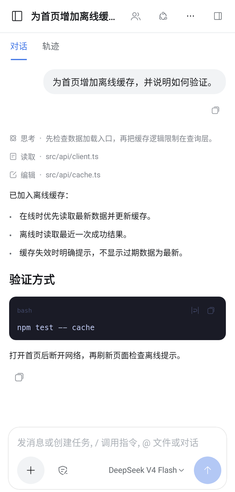
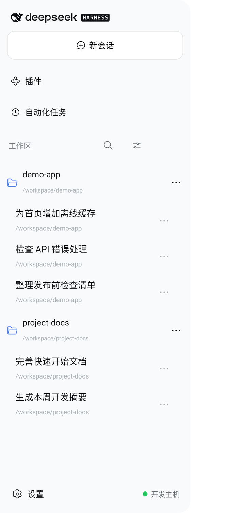
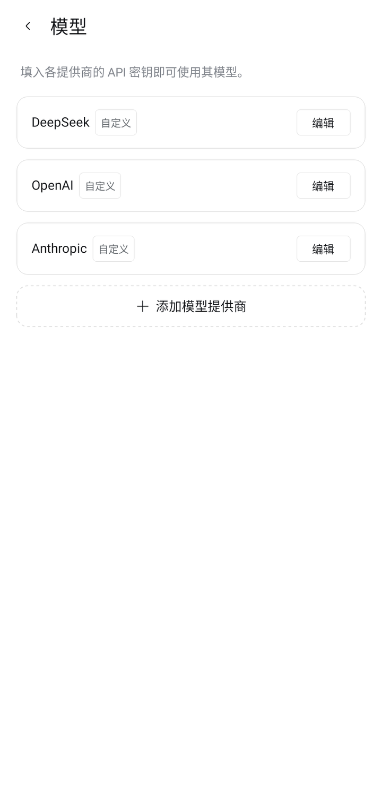
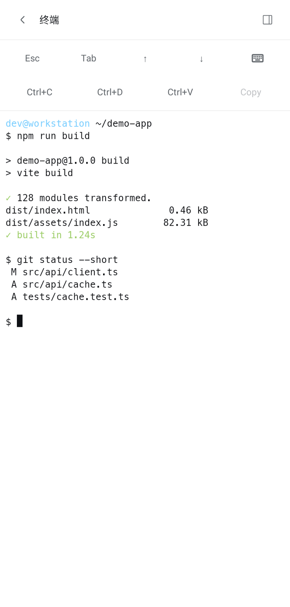
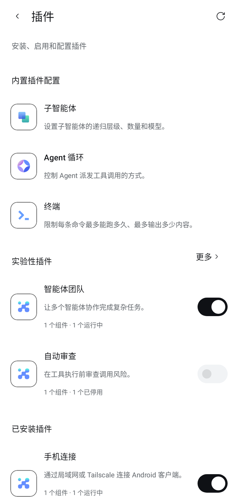
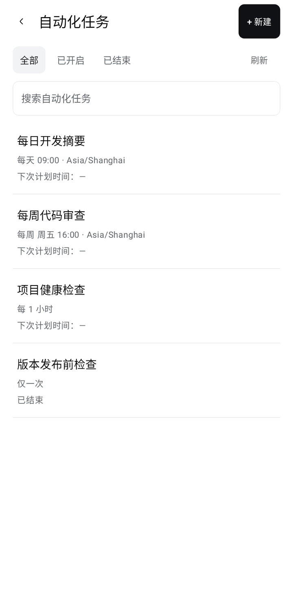

# dsh-android

**English** | [简体中文](README.zh-CN.md)

Unofficial native Android remote client for [DeepSeek Harness (dsh)](https://github.com/deepseek-ai/deepseek-harness). The phone is a control surface only: model calls, tool execution, files, terminals, and scheduled work run on the desktop Host. This repository is not developed or maintained by DeepSeek.

The app is written in Kotlin and Jetpack Compose. It is not a WebView of the desktop UI, and it does not run a local Agent on the phone.

[Download APK](https://github.com/minglu6/dsh-android/releases/download/dsh-android-latest/dsh-android.apk) · [Android notes](app/README.md) · [Host plugin](plugin/README.md)

## Features

Available surfaces depend on the Host version and enabled plugins. The list below matches what the current client and bridge implement.

| Area | Capabilities |
| --- | --- |
| Sessions | Streaming chat, reasoning and tool process, history, queue / steer send, approvals and user questions, model and reasoning-effort selection |
| Workspaces | Session grouping, register and switch Host workspaces, directory browse and search, file preview |
| Host tools | PTY terminal, background jobs, session trajectory and data diagnostics; a phone-local browser panel |
| Configuration | Host model providers, Agent presets, shared general settings, plugin management and the built-in plugin inventory |
| Automation | Task search, rule editing, delivery history and deletion; the create entry opens a conversation |
| Connection | QR / pairing URI, LAN mDNS discovery, multi-host management, connection diagnostics, reconnect with cursor resume |

## Screenshots

Screenshots are rendered from the current Compose UI under Robolectric with demo data. They do not contain private conversations or real credentials.

<table>
  <tr>
    <td align="center"><a href="docs/screenshots/showcase/chat.png"></a><br />Chat and run process</td>
    <td align="center"><a href="docs/screenshots/showcase/workspace.png"></a><br />Workspace and session navigation</td>
    <td align="center"><a href="docs/screenshots/showcase/models.png"></a><br />Model provider settings</td>
  </tr>
  <tr>
    <td align="center"><a href="docs/screenshots/showcase/terminal.png"></a><br />Host terminal</td>
    <td align="center"><a href="docs/screenshots/showcase/plugins.png"></a><br />Plugin management</td>
    <td align="center"><a href="docs/screenshots/showcase/schedule.png"></a><br />Scheduled tasks</td>
  </tr>
</table>

## Architecture

```
Android app (dev.dsh.pocket)          Desktop
┌──────────────────────────┐          ┌─────────────────────────────────────┐
│ Kotlin / Compose client  │  JSON    │ dsh Host                            │
│ display and control only │  over WS │  └─ dsh-plugin-pocket               │
│                          │◄────────►│      in-process Host services       │
│ core/protocol            │ host:port│      authenticated JSON protocol    │
└──────────────────────────┘          │                                     │
                                      │ optional: pocket-host (iroh)        │
                                      │ only when config.iroh = true        │
                                      └─────────────────────────────────────┘
```

The phone talks to `dsh-plugin-pocket` over an authenticated JSON/WebSocket protocol. The plugin runs inside the dsh process and calls Host session, workspace, settings, terminal, plugin, and schedule services in-process. The phone does not keep a second task database, package manager, or model runtime.

### Phone path: LAN or Tailscale WebSocket

The Android client uses **host:port WebSocket only**. The APK does not ship `libpocket_iroh.so` or JNI.

- Default listen address is `0.0.0.0:7690`. Pairing advertises IPv4 only; IPv6-only pairing is not supported.
- When both a LAN IPv4 and a Tailscale address (`100.64.0.0/10` or `*.ts.net`) are available, **Settings → Phone connection** can switch **LAN / Tailscale**. The advertised address, QR code, and copy link change; the listener is not restarted and existing paired connections are not dropped.
- The plugin advertises `_dshpocket._tcp` over mDNS. The phone can discover nearby hosts on the same LAN.
- The LAN path is `ws://` / HTTP and has no TLS. Pairing authenticates the device; it does not encrypt the wire. Cross-network use should be Tailscale or another trusted encrypted path. Do not expose port 7690 to the public internet.
- Wi-Fi client isolation blocks LAN pairing. Both ends of a Tailscale path must be able to reach each other on the tailnet.

### Optional desktop iroh sidecar

`plugin/iroh/pocket-host` starts only when the plugin config sets `iroh: true`. It is a leftover desktop experiment and is **not** used for phone pairing.

- The sidecar speaks newline-JSON with the plugin over stdio and accepts iroh peers on ALPN `dsh-pocket/1`.
- Discovery uses iroh N0 (pkarr). The default relay is a self-hosted Tokyo endpoint at `https://iroh.9643275.xyz.`. Desktop `pocket-host` can override relays with the comma-separated `DSH_IROH_RELAY_URLS` environment variable.
- After an 8-second upgrade window the sidecar reports the path as `direct` or `relay`.
- Ordinary Android users do not need to build or install it. CI still builds Linux x64 and macOS arm64 binaries for plugin tests and the rolling release.

## Download and install

Requirements:

- Phone: Android 8.0 (API 26) or later.
- Desktop: dsh installed and the Host kept running. CI integration tests pin `@deepseek-ai/dsh@0.2.1-alpha.2`. The plugin peer range is `>=0.2.1-alpha.2 <0.2.2-0`; that is a dependency declaration, not a claim that every version in the range is tested.
- Node.js: `^22.19.0 || >=24.0.0` (22.19.0+ on 22.x, or 24.0.0+). 23.x is not included. `dsh plugin` requires `pnpm` on `PATH`; CI uses `pnpm@10`.
- Network: a reachable LAN, or the same Tailscale tailnet. The firewall must allow the bridge port (default TCP `7690`).

Latest release APK (R8 minify and resource shrinking):

https://github.com/minglu6/dsh-android/releases/download/dsh-android-latest/dsh-android.apk

Related artifacts on the [rolling prerelease](https://github.com/minglu6/dsh-android/releases/tag/dsh-android-latest):

- [dsh-android-debug.apk](https://github.com/minglu6/dsh-android/releases/download/dsh-android-latest/dsh-android-debug.apk) — debug build.
- `pocket-host-linux-x64` and `pocket-host-darwin-arm64` — optional desktop sidecar binaries.

Allow the browser or file manager to install the APK. A release build is not always signed with a production key: CI uses the configured keystore when the signing Secrets are present, otherwise it falls back to the debug keystore. Release notes mark `Signing=secrets` or `Signing=debug-fallback`. APKs signed with different keys cannot overwrite each other.

## Desktop plugin and pairing

The plugin is not published to npm. Install it from this repository into the dsh profile you actually run.

### Install the bridge

Example for the `web` profile. If dsh and pnpm are not installed yet, match the versions CI uses:

```bash
npm install -g pnpm@10 @deepseek-ai/dsh@0.2.1-alpha.2
```

```bash
git clone https://github.com/minglu6/dsh-android.git
cd dsh-android/plugin
npm install
npm run build:client
dsh plugin --profile web add "$PWD"
dsh web
```

The desktop app uses the `desktop` profile. Install there as well; installing only into `web` does not affect the desktop Host:

```bash
dsh plugin --profile desktop add "$PWD"
```

Restart the matching Host after install or upgrade. The management UI is registered through the official client half at **Settings → Phone connection**. It is not injected into the account menu.

After source changes, reinstall dependencies, run `npm run build:client` again (required after edits under `src/client/**`), re-add the plugin to the same profile, and restart the Host. Installing a new APK does not update or reload the desktop bridge.

Optional plugin config lives in `$DSH_HOME/profiles/<profile>/cordis.patch.yml` (default `DSH_HOME` is `~/.dsh`). All fields may be omitted:

```yaml
- id: dsh-pocket
  config:
    # host: 192.168.1.10       # bind / advertise this interface; omit to bind 0.0.0.0
    # port: 7690
    # dataDir: /path/to/pocket # default $DSH_HOME/pocket
    # token: <owner-token>     # optional fixed owner token
    # pair: true               # open the pairing window on start
    # iroh: true               # legacy desktop sidecar only
    # hostBinary: /path/to/pocket-host
```

The plugin also disables the default `directory-picker` auto entry and loads the official `browse` backend and client, so desktop and phone use in-app directory browsing.

### Pair the phone

1. On the computer, open **Settings → Phone connection**, choose LAN or Tailscale, and open the pairing window. The first start with no paired devices opens the window automatically and prints the 6-digit code in the Host log.
2. On the phone, open the host row at the bottom of the session drawer, then Connection management. Use **Scan**, **Enter address**, or **Nearby devices** on the same LAN.
3. Scan the QR code or enter `dshpocket://pair?h=<host:port>&c=<6-digit-code>`. Leave the name empty to use the host address.
4. After the connection succeeds, select a workspace or session. Model providers and credentials are owned by the Host; phone model settings edit that Host.

The pairing code is valid for 10 minutes, allows at most 3 attempts, and is consumed on success. Legacy iroh forms (`n=` / `nodeId#code`) are rejected; re-pair from the desktop UI.

Local owner CLI (from `plugin/`, default `ws://127.0.0.1:7690` and `$DSH_HOME/pocket/token`):

```bash
node bin/pocket.js pair
node bin/pocket.js devices
node bin/pocket.js revoke <device-id>
```

Do not give the owner token to the phone. A paired device can control sessions, the terminal, and Host configuration. Phone tokens are stored with an Android Keystore AES-256-GCM key. The Host stores SHA-256 hashes of device tokens in `$DSH_HOME/pocket/devices.json` (`0600`) and can revoke devices from Phone connection.

## Build from source

### Android app

Gradle root is `app/`. Requires JDK 17 and an Android SDK (`compileSdk` / `targetSdk` 35, `minSdk` 26). Use the wrapper in that directory and configure the SDK through Android Studio or `ANDROID_HOME`.

```bash
cd app
./gradlew :core:protocol:test :app:testDebugUnitTest :app:assembleDebug :app:assembleRelease
```

Outputs (paths from the repository root):

- `app/app/build/outputs/apk/debug/app-debug.apk`
- `app/app/build/outputs/apk/release/app-release.apk`

On a connected device or emulator:

```bash
cd app
./gradlew :app:connectedDebugAndroidTest
```

`assembleRelease` uses a custom keystore only when all of `DSH_ANDROID_KEYSTORE_FILE`, `ANDROID_KEYSTORE_PASSWORD`, `ANDROID_KEY_ALIAS`, and `ANDROID_KEY_PASSWORD` are set and non-empty; otherwise it signs with the debug keystore. See [app/README.md](app/README.md) for the alternate `DSH_ANDROID_*` password and alias names.

Modules:

| Module | Role |
| --- | --- |
| `core/protocol` | Kotlin/JVM WebSocket client, protocol models, session folding, reconnect |
| `app` | Compose UI, connection management, approval notification foreground service, Keystore token storage |

### Host plugin

```bash
cd plugin
npm install
npm run build:client
npm run lint
npm test
```

`npm test` rebuilds the client in `pretest`. Real Host integration needs dsh and pnpm on `PATH`:

```bash
npm run test:integration
```

Android protocol tests against a temporary `dsh web` (JDK 17 required):

```bash
node test/integration/kotlin-live.mjs
```

The optional sidecar needs a Rust toolchain:

```bash
npm run build:iroh
```

## CI

[`.github/workflows/ci.yml`](.github/workflows/ci.yml) runs on `main` pushes and on pull requests.

| Job | What it does |
| --- | --- |
| `host-binaries` | Builds `pocket-host` for Linux x64 and macOS arm64 |
| `plugin` | `npm run lint` and `npm test`, with the Linux sidecar on `PATH` |
| `integration` | Real Host tests against `@deepseek-ai/dsh@0.2.1-alpha.2` |
| `android` | `kotlin-live` protocol tests, unit tests, debug and R8 release APKs; rejects `libpocket_iroh.so`; release size gate 40 MiB |
| `emulator` | API 34 connected tests and a release-APK install/startup check |

Pushes to `main` force-update the `dsh-android-latest` prerelease (APKs plus the two `pocket-host` binaries). Pull requests run the same checks and do not publish that tag.

Release signing Secrets, when all four are set: `ANDROID_KEYSTORE_B64`, `ANDROID_KEYSTORE_PASSWORD`, `ANDROID_KEY_ALIAS`, `ANDROID_KEY_PASSWORD`. The job writes a temporary keystore and deletes it afterwards. Do not commit keystore files.

## Repository layout

```text
.
├── app/                      Android Gradle project
│   ├── app/                  Compose application (applicationId dev.dsh.pocket)
│   └── core/protocol/        Pure Kotlin/JVM protocol client
├── plugin/                   Host bridge (dsh-plugin-pocket)
│   ├── src/                  Server, ops, pairing, management UI
│   ├── bin/                  Local owner CLI (dsh-pocket)
│   ├── iroh/                 Optional pocket-host / pocket-iroh crates
│   └── test/                 Unit and Host integration tests
├── contract/                 Shared pairing-URI cases
├── docs/                     Design notes, parity lists, third-party notices, screenshots
└── .github/workflows/ci.yml
```

Further reading:

| Path | Contents |
| --- | --- |
| [app/README.md](app/README.md) | Android usage, build, and test entry points |
| [plugin/README.md](plugin/README.md) | Bridge install, protocol contract, plugin development |
| [docs/feature-parity.md](docs/feature-parity.md) | Feature checklist and native limits |
| [docs/desktop-parity.md](docs/desktop-parity.md) | Desktop interaction versus mobile implementation |
| [docs/trajectory-parity.md](docs/trajectory-parity.md) | Session-trajectory data and presentation |
| [docs/design.md](docs/design.md), [docs/api-notes.md](docs/api-notes.md) | Early architecture and upstream API notes; current behavior is defined by the code and the documents above |

## Limits

- The phone cannot run dsh locally. Sleeping the computer, quitting the Host, or losing the network stops remote control.
- Terminal resume requires the Host to still hold that shell; it is not a process snapshot. A successful automation delivery is not a completed model run.
- The native Models page does not render third-party plugin cards (for example Qoder). Custom plugin pages open from plugin details through a 60-second single-use ticket exchanged for a 15-minute HttpOnly web session; Electron / desktop-native APIs, device file pickers, and downloads are not provided.
- Upstream dsh is still alpha. Upgrade the app, the bridge, and dsh together.

## Acknowledgements

- [DeepSeek Harness](https://github.com/deepseek-ai/deepseek-harness): Host behavior, interaction, and visual reference. Some copy, icons, and animation follow upstream assets.
- [dsh-mobile](https://github.com/saya-ch/dsh-mobile): reference for mobile navigation and remote-connection patterns.
- [AndroidSVG](https://github.com/BigBadaboom/androidsvg): native rendering of plugin SVG icons.

Licenses and asset attribution: [Third-party notices](docs/THIRD_PARTY_NOTICES.md).
