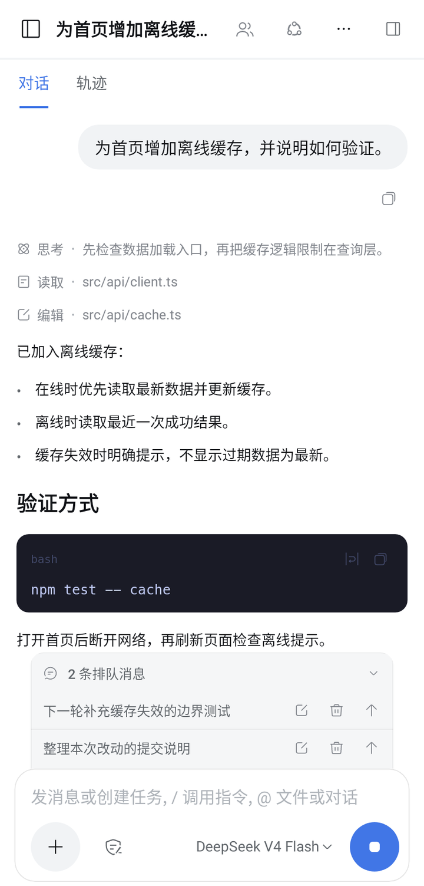
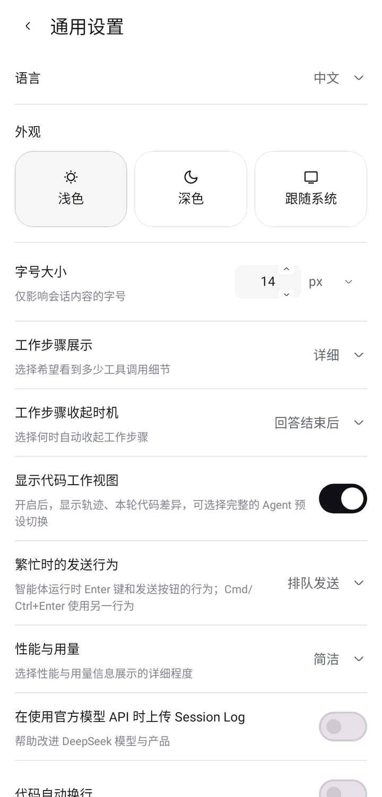
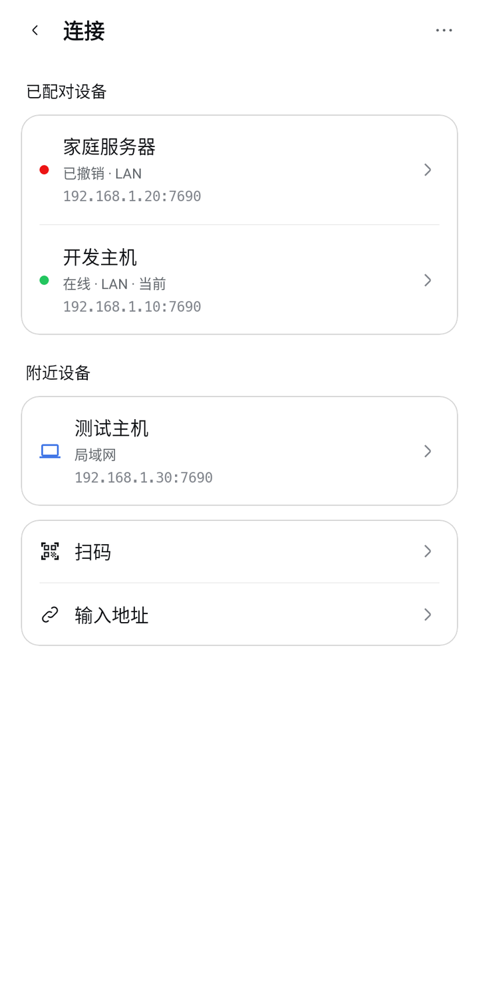

# Android App

使用 Kotlin / Jetpack Compose 实现的原生 Android 客户端：**高度复刻桌面版 DSH，让你像使用手机应用一样，操作电脑上的 DSH。** 功能入口与交互逻辑尽量保持桌面习惯，布局、触控与软键盘则针对手机适配；不是桌面画面的远程投屏，也不是精简的聊天替代品。

模型、工作区文件、终端进程与自动化任务在电脑 Host 上运行；手机负责展示与控制。项目定位、APK 下载及 Host 安装见 [根 README](../README.zh-CN.md)。

## 连接与日常使用

1. 电脑安装桥接并启动对应的 dsh profile，在 **设置 → 手机连接** 打开配对窗口。
2. 手机点击会话侧栏底部的主机信息，进入连接管理，选择 **扫码**、**配对链接**、**输入地址** 或 **附近设备**。配对格式为 `dshpocket://pair?h=<host:port>&c=<6位码>`。电脑复制链接后，手机选择 **配对链接 → 粘贴链接 → 下一步**，核对自动填入的地址和配对码，再点击 **开始配对**；读取剪贴板仅在点击粘贴时发生。空剪贴板、无效或不完整的链接会提示错误，不会发起连接。
3. 名称留空时使用远程主机地址。已配对设备显示地址与 `LAN`／`Tailscale` 路由；主机状态点区分在线、连接中、离线和认证失效。每个非当前设备行右侧显示「切换」按钮，沿用 DSH 普通文字按钮样式（正文色、常规字重、透明背景），点击直接切换，无中间选择弹窗；当前设备不显示该按钮，连接信息不完整的设备按钮禁用。「切换」右侧保留独立管理箭头，点击箭头或设备信息可管理重新配对、重命名和删除，不触发切换。扫码使用二维码图标，配对链接使用链条图标，输入地址使用键盘图标，分别表达扫描、链接导入和手动填写；重新配对使用循环箭头图标。
4. 选择工作区和会话，或在欢迎页发送新会话的首条消息。电脑需保持运行，手机不能脱离 Host 独立执行任务。

手机 token 使用 Android Keystore 的 AES-GCM 密钥加密保存；不再使用的设备应在电脑「手机连接」中撤销。

连接只走 host:port WebSocket，APK 不包含 iroh JNI。局域网无需 Tailscale；跨网络应使用 Tailscale 或已有可信加密链路，桥接的 LAN HTTP／WebSocket 本身不提供 TLS。旧 iroh 连接配置需重新配对，IPv6-only 配对地址不受支持。

### 补充界面

以下截图由当前 Compose 界面在 Robolectric 中使用演示数据渲染。聊天、工作区、模型、终端、插件和自动化的演示见 [项目首页](../README.zh-CN.md#界面截图)。

<table>
  <tr>
    <td align="center"><a href="../docs/screenshots/showcase/queue.png"></a><br />待执行消息队列</td>
    <td align="center"><a href="../docs/screenshots/showcase/settings.png"></a><br />通用设置</td>
    <td align="center"><a href="../docs/screenshots/showcase/connections.png"></a><br />主机连接管理</td>
  </tr>
</table>

## 聊天与发送行为

有序列表编号与正文使用相同字体和行高，并按正文首行基线对齐；正文折行时编号保持在首行，浅色、深色和大字号均遵循此规则。

### 首条消息

新会话点击发送后立即本地回显并显示「发送中...」。创建、配置与订阅期间保留消息和输入草稿，不切换为空白页面；首条确认前禁止重复提交，确认后恢复正常发送。创建、配置或发送失败会保留原文与错误，可选择「重新编辑」。离开会话后，过期回执不会重新打开该会话或继续发送。

同一提交的本地回显、Host 消息及快照通过 `requestId` 关联，避免重复展示；新会话不等待无关的权限回读与反馈查询。

### 排队与插话

- 运行中连续发送默认使用 **排队发送**，发送偏好与桌面共享 `ui-conversation.busyEnter`；只有显式选择 **插话发送** 才引导当前轮次。
- 排队消息显示在输入栏上方：单条预览，多条默认折叠，可展开；仅未确认消息显示「发送中」。被 Host 正式消费后才进入聊天正文。
- 已确认消息可编辑、删除或插话；含附件／非文本内容不能文本编辑，插话仅在当前轮次运行时可用。操作结果以 Host 收件箱更新为准。
- 重复文本按不同 `requestId` 区分；发送失败清理对应回显，重连后从 Host 收件箱恢复队列。

### 历史轮次分叉

- 每个已结束轮次的最后一条回复均可分叉，不限于整个会话的最新回复；后续轮次正在运行也不影响历史轮次的入口。
- 分叉使用该轮 Host `turn/end` 的精确序号，保留截至该轮的历史，不包含后续轮次。尚未结束或缺少轮次结束边界时不启用分叉，也不会默认改为分叉最新轮次。

### 团队与子智能体地址

- 团队成员和共享任务只读取 Host 的 `agentTeam` 投影；普通子智能体目录读取 `subagentCatalog`，不会把全部子会话或普通分叉当作团队成员。成员名称、角色、生命周期、任务依赖、负责人及诊断保留 Host 原值。
- 会话页头参考 dsh-ios 的紧凑排布（`8534cdf`），标题右侧依次排列团队图标、工作模式图标和「N 个子智能体」，不再增加第二行工具栏。只有团队和模式隐藏可见名称，均保留 14dp 图标、无边框背景；团队可打开弹框，模式只读。子智能体入口直接沿用桌面文案与样式，例如「6 个子智能体」：12sp 三级灰色文字、18sp 行高、4dp 图文间距、14dp 下拉箭头、水平 2dp／垂直 3dp 内边距；透明、无描边，不反转文字顺序、不采用纯数字缩写。无障碍名称完整保留，预设仅在新建会话时选择。
- 工作模式首帧使用当前会话摘要 `projections.values.agentPreset` 的真实记录值，随后由 `follow` 快照／增量投影校准；不借用新建任务默认值或上一个会话的模式。摘要未知时仍等待真实快照，完整快照明确未提供预设时会清除旧值。该首帧优化需要桥接和 App 同时更新；只安装新 APK、但未重载旧桥接时，仍可能等待历史快照。
- 子智能体不是同 ID 的主会话。打开、重连、历史补页、投影读取、续聊及停止均保留 `sessionId + parentSessionId + subagentMode` 地址；回到主会话后恢复仅含主会话 ID 的地址。地址或目录缺失时不偷偷改为打开主会话。
- `one-shot` 与未确认类型的 `unknown` 子智能体仅查看历史，不发送消息、插话或停止。只有 `continuable` 支持续聊和停止；续聊不支持非图片文件附件。历史中的模型失败原样展示，不会因打开成功而被清除或改写。

### 过程、模型与审批

- 聊天按正文与输入边界分组过程；标准模式默认收起，详细模式运行时平铺。思考与工具执行期间保留「深度求索中」，计时使用 Host 轮次起点，缺少起点不编造秒数。
- 工具参数流式生成时按桌面类别显示「准备运行命令／准备读取文件」等准备态；工具名尚未到达时不显示占位调用。模型消息提交不代表开始执行，收到 Host `tool/call` 才切换到运行态。准备行不可打开工具详情；中断前未派发的准备调用不计作已执行，重连恢复当前准备态，历史执行记录不重放准备阶段。
- 模型重试按 Host `retryId` 与轮次／步骤合并成一条默认收起的摘要，原位更新次数、等待倒计时和取消状态；展开查看当前重试的延迟与失败原因。最终失败独立显示红色标题、原因和错误码，不被过程折叠隐藏。重连与历史补页保留链身份，不重复铺开等待／开始通知；不改变 Host 重试策略。
- 输入栏上方的模型浮层分为「模型」与「推理等级」，超过四个模型时提供搜索。等级名称与默认值来自 Host，切换模型不继承旧等级；失败保留原选择，桌面切换也会同步。
- 输入框模型按钮、当前模型菜单行及模型选项共用绿色版本胶囊。按当前官方 `ui-deepseek-model-label-1017` 的匹配规则，仅 `deepseek-official`／`deepseek-account` 下 ID 为 `deepseek-flash`、目录名称为 `DeepSeek-V4.1-Flash` 的模型显示 `1017`；其他提供方、Pro、旧名称及自定义名称不添加标记。标记是手机端固定展示，不代表实时探测到的服务端版本，也不会随桌面 UI 插件开关自动变化；模型请求、目录名称、搜索及无障碍名称保持不变。窄屏省略模型名称但保留徽标，浅色／深色主题均支持。
- 审批和提问接管输入区，失败保留答案，多题可返回修改。权限选项来自 Host 动态目录；自动审查仅在 Host 支持时出现，需确认风险，不能设为新会话默认权限。
- 选择卡片同时接收实时提问和 `userQuestions` 会话投影，重新打开会话／重连可恢复待答项，桌面已回答或已排队的回复不会再次要求提交。限时等待结束后，仍开放的问题以“智能体已继续工作”提示补充作答。
- 卡片支持首项推荐默认选择、单选／多选、自定义答案、逐题前进／返回和明确跳过；单选与自定义互斥，多选可附加文字。选中不是提交，最后一题必须确认；未完成题会阻止整组提交。收起重开保留页码与草稿，长正文独立滚动，标题和提交按钮固定；离线或提交中禁止修改答案。
- `/` 指令、`@` 引用、目标与任务清单来自当前 Host。用量与性能使用实际投影，缺失数据不伪造为数值；详细统计可从「性能与用量」查看。
- `+` 与 `/` 使用同一完整指令菜单，沿用桌面的“添加／指令”分组、排序和搜索；行内 `/` 按 Host `input.hint` 规则过滤，不把菜单缩成固定快捷项。
- 任务栏按桌面规则显示「已完成 · 进行中 · 待处理」的非零数量，不再只显示完成数／总数。点击清单标题或右侧箭头在原卡片中展开／收起，不弹底部详情页；列表使用绿色完成点、灰色运行转圈和灰色待处理点，长列表限高滚动。状态实时更新，切换会话时恢复收起；保留任务文字长按选择。
- 对话右侧提供真实轮次刻度；点击跳转，尚未加载的轮次先补齐历史，长按预览该轮提问和最新回答。上滑阅读暂停跟随，输入框上方的「回到底部」按钮恢复跟随；切换会话或再次导航会取消旧的待定位动作。
- 对话左上角截断标题可点击，使用桌面同款深色浮层显示完整标题、真实相对时间和当前状态。侧边栏会话记录与此独立：仅当前选中且溢出的标题跑马灯显示，取消选中立即复位到标题开头并恢复省略号；未选中与短标题不滚动。

### @ 文件与会话引用

- 在原输入框键入 `@`，候选菜单紧贴输入卡片上方；继续输入即可搜索，不再打开独立搜索弹层或转移输入焦点。候选按文件与文件夹、当前会话的直接子智能体、其他对话分组，空分组隐藏。
- 点文件或会话即可插入引用；点目录正文引用整个目录，点行尾箭头进入目录。下钻后的面包屑可返回上级或工作区；外接键盘支持上下选择、Enter 选中、Tab 下钻、Shift+Tab／Escape 关闭，Android 返回键也可关闭菜单。点击输入卡片内不关闭候选，点击卡片和候选之外关闭。
- 新会话首次使用 `@` 会按当前工作区、模型、权限和预设准备空会话，保留正在输入的草稿；无需先发消息，等待会话历史打开后才查询候选。
- 已选引用显示为图标和短名称，复制与发送仍使用原始规范引用，不根据标题重建会话身份。删除与选区以完整引用为单位，点文件引用可打开预览。带空格路径自动加引号；显式带引号的查询只搜索文件。
- 文件与会话候选独立处理失败，某一类不可用不会清空另一类的结果。
- 样式与行为依据官方 `MenuView`、`ui-reference` 和 `ReferenceIcon` 源码：紧凑单行、统一线框图标、灰色选中态、右对齐时间／路径、轻阴影与细滚动条。查询更新期间保留候选但禁止选中旧结果；中文输入法组词期间不拦截候选确认键。

### 本轮文件改动

- 完成回复正文下方、消息操作栏上方显示「已编辑 N 个文件」卡片：官方文件图标、Host 汇总增删行数、逐文件路径和增删统计；默认显示四行，可展开全部记录文件并收起。单文件直接显示文件名；二进制／过大文件保留真实状态，不伪造行数。
- 点击标题或文件，通过 `workspaceChanges.diff(sessionId, seq, index)` 查看该轮保存的差异，保留 Host 原始文件顺序；不会改读文件当前内容。与对话文件入口共用 `FilePreviewChrome` 和离线 Shiki 渲染器，统一文件图标、文件名、前部省略路径、模式／换行／刷新及复制。完整新增／删除文件按普通源码样式展示，增删计数放在语言／复制栏，不重复显示标题、说明或逐行色块；混合／片段差异保留必要的旧／新行号与标识。读取失败可重试，最多绘制 5000 行并明确提示截断；历史快照缺失仍明确显示不可用。
- 关闭「显示代码工作视图」时不请求或展示卡片。摘要未加载、为空或被 Host 释放时不显示占位卡片；同一轮只保留最新宣告。
- 文件列表使用已有 `workspaceChanges.summary` 能力；点击查看差异还需要更新并重启电脑桥接，使其公布 `workspaceChanges.diff`。升级 APK 不会重启 Host；重启也会使旧内存摘要失效。

### 流式同步与恢复

- 网络事件按接收顺序交付，原始事件不合并、不静默丢弃；有界队列超限会明确断开并重新同步，避免继续显示不完整会话。
- 普通流式文字最多每 50ms 合并发布一次；最终消息、轮次结束、Host 运行状态和同步错误立即发布，包含此前已接收的内容。
- 轮次运行状态与模型流式预览分离。旧 attempt、重复帧和旧连接不能重新开启已经结束的轮次；`revision`／`index` 缺口或 Agent 生命周期重置会触发重新订阅，使用 Host baseline 恢复。
- 切换会话、主机或订阅会取消旧的延迟发布；重同步不会重发提示词，也不会把同步失败伪装成生成完成。
- 任务清单沿用桌面生命周期：`todo/write` 替换清单，全部完成及 `turn/end` 后仍保留；下一次 `turn/start` 清空。快照、续订和增量投影中的显式 `todos: null`／`[]` 同样清空，缺失键不等于清空；投影水位与历史游标分离，旧响应和历史补页不能复活旧清单。历史 `todo_write` 参数与结果仍可查看。
- 聊天正文、轨迹和会话数据诊断的历史分页不再需要点击「加载更多／加载更早」：向更早记录滚到顶部或在顶部下拉即可补页。聊天与轨迹窗口不足一屏时会自动回填，诊断初次打开仍跟踪最新，不擅自遍历全部历史。补页保留阅读锚点、关闭自动追随底部；同一边界失败后不会因新输出或重组自旋，可再次下拉重试，末页停止请求。

## 工作区与主机工具

| 功能 | 使用方式与边界 |
|---|---|
| 工作区 | 支持注册、重命名、移除、组内新会话、目录树、搜索和排序；以 Host 实体区分，同名目录不合并。文件面板订阅当前目录变化自动更新，关闭、后台及切换目录时释放订阅，保留手动刷新。目录选择支持浏览、隐藏文件与新建目录；仅提供 `native` 选择器的 Host 保留完整路径输入。 |
| 文件预览 | 代码使用与桌面相同的 Shiki 语法、浅深色高亮和物理行号，支持代码／纯文本切换、换行／横向滚动及原文复制；另支持缩放图片、完整 PDF、Markdown、CSV/TSV、安全静态 HTML，以及 DOC/DOCX、PPT/PPTX、XLS/XLSX 只读预览。 |
| 终端 | 连接主机 PTY，支持控制键、选区复制、粘贴与多终端切换。返回或收起只取消订阅，菜单「退出」经确认后才结束目标 Shell。 |
| 浏览器 | 使用手机 WebView，支持新建、切换、关闭标签，各标签保留独立前进／后退历史；用户点击触发的新窗口进入新标签。支持刷新和在系统浏览器打开，非用户手势弹窗仍被拒绝。 |
| 轨迹与诊断 | 查看会话轨迹、原始记录、分组、筛选及可折叠 JSON 详情；顶部下拉／向更早记录滚到顶自动补页，无手动分页按钮。复制按钮按值类型复制，长按提供桌面对应的 JSON／属性路径选项。聊天选取可定位到对应诊断记录。 |
| 后台任务 | 对话／轨迹行右侧显示桌面同款圆环、「N 个后台任务运行中」和下拉箭头；没有进行中任务时显示未清空的后台任务总数。入口打开锚定弹框，进行中为双行卡、已结束为紧凑单行，保留真实命令、退出信息和耗时。已结束组可折叠，「清空」仅本机隐藏已结束记录，不删除 Host 记录或终止任务；新结束任务仍会出现。仅可展开进行中或保留输出的任务；停止需二次点击确认，等待 Host 权威状态。前台在线每 3 秒刷新，失败明确显示状态不可用；关闭弹框释放输出订阅。 |

侧边栏、欢迎页工作区按钮和选择列表统一使用 Host 工作区标题。自动标题 `default-workspace` 与桌面端一样按语言显示为「默认工作区」／「Default workspace」；自定义标题保持原文。缺少标题时才提取目录名，同时支持 Windows `\`、UNC 和 `/` 路径；完整路径保留在选择列表的副标题中，侧边栏不显示路径，不改写 Host 路径或存储名称。

工作区行不显示展开三角，点击整行即可展开／收起。始终显示开／合文件夹：当前工作区及工作区树的祖先为蓝色，其他工作区为灰色，同路径的其他工作区不连带高亮。欢迎页尚未进入会话时，与输入区共用工作区选择。

已归档会话仍可从侧栏重命名和分叉，不提供置顶。会话右上角“更多”仅保留日志下载和反馈；重命名位于侧栏，分支也可从消息操作栏进入。

会话运行时仅在会话标题左侧显示桌面同款灰色转圈，等待审批／回答时改为黄色提示，结束后移除。工作区不汇总组内、子工作区或置顶会话的活动状态，展开与收起时均保留文件夹图标，不显示转圈或待交互提示。系统关闭动画时，会话运行指示保留静态圆环。

任务结束但尚未查看时，会话标题左侧显示绿色小圆点；在任一端打开并实际查看会话后，两端同步清除。后台跟随、抽屉覆盖、其他页面及未加载完成的会话不算查看；运行中和待审批／回答状态优先，归档会话不显示绿点，工作区仍保持文件夹图标。未读状态由 Host 桥接统一保存，重连后恢复，Host／桥接重启后重置。桌面消费同一份 Host 快照：有 `setCompletionUnreadSource` 则注入，否则叠加官方 `sessionStatus.completionUnread`。

终端会保存连接配置、所属会话及已知终端身份，重开面板／App 时可重新附加 Host 保留的 Shell。它不是进程快照：Host 重启或闲置回收后无法恢复已消失的进程，也不会把不存在的指定终端偷偷换成新 Shell。多行粘贴需确认，断线后禁止发送但保留输出供复制。远端平台由桥接返回，用于选择快捷键；旧桥接缺少该信息时显示通用 Ctrl 标记。

侧栏与右侧面板自动适配宽度，不提供手动「手机／桌面」布局选择。宽度达到 760dp 时可使用双栏侧栏，同时为主内容保留至少 480dp；窄屏使用抽屉。

## 设置、插件与自动化

### 与 Host 共享配置

语言、字体与字号、聊天展示、性能与用量、繁忙发送行为、默认权限和日志上传等读写桌面同一配置。保存携带 Host revision 并回读确认；桌面变更通过 `settings.changed` 更新手机。离线、只读、冲突或覆盖不会伪装成成功，失败重试只重新读取，不自动重放写入。切换主机清除旧配置镜像与过期结果。

Host 断连、连接中或认证失效时，需要连接的入口与修改控件置灰并禁止点击；设置页使用中性文字说明，不再等点击后才提示未连接。通用设置按各字段的可写状态禁用，已打开的选择框、保存／删除确认和远端刷新同样受限。模型配置断线后保留草稿，恢复连接需先回读最新配置再提交；恢复不会自动重放修改。连接管理、设备专属设置、取消返回及已加载内容的本地阅读／复制／折叠不受影响。

连接、换行、外观等设备专属项留在本机；外观写入 App SharedPreferences，不调用 Host mutate，也不被 `ui-theme` / `settings.changed` 覆盖。「工作步骤收起时机」仅在本次应用实例保持。字体在手机本地解析，不下载电脑端字体。Agent 预设来自 Host，支持查看模式帮助与只读 YAML；创建自定义预设进入会话草稿，不自动发送。

### 模型与插件

模型页保持全原生：提供商列表、API 密钥／地址／协议、模型目录与增删表单均调用 Host API，不嵌入网页。Qoder CN 连接卡片沿用桌面的 PAT 状态、VPC 实例和高级端点字段，使用同一 `llm-qoder` 配置与凭据服务；先执行 revision 校验，再写入 PAT。配置成功而凭据失败时保留已提交 revision 与未保存草稿，重试不重复覆盖配置；PAT 永不回显或持久化到手机草稿。

侧栏“插件”提供内置配置、实验性插件与已安装插件；添加菜单沿用桌面的安装与“让 Agent 创建插件”，后者只进入创造模式草稿，不自动发送。设置中的“内置插件”保持原生只读目录：搜索图标、标题左侧折叠箭头、同一行右侧中性色模式选择器，以及卡片箭头交互均按桌面实现，不增加“查看详情”文字按钮。自动化任务仅从侧栏进入。

### 自动化

支持任务搜索、常用 Cron 构建与高级原文编辑、投递历史和删除；新建入口进入会话。未修改的时间精度和时区别名保持不变。插件与自动化列表接收 Host 变更通知，并保留手动刷新。**投递回执不代表模型执行完成。**

任务运行记录使用独立滚动列表：顶部下拉刷新最新一页，滑到底部按 Host `nextBefore` 自动续页，短页可继续填满视口；不再显示「刷新／加载更多」按钮。分页保留已加载记录并按 `messageId` 去重，末页、清理和保留规则提示仍保留。失败或游标不前进时停止自动请求，保留错误与明确重试入口；下拉刷新不会被底部续页抢占，切换任务后旧响应不能覆盖新记录。

## 版本与能力限制

App 在 `hello`／`pair` 交换版本信息，并根据 Host 公布的操作能力显示入口。新功能需要相应版本的桥接；仅安装新 APK 不会重载电脑插件。当前支持基线与网络前提见 [根 README](../README.zh-CN.md#下载与安装)。

详细对照见 [功能清单](../docs/feature-parity.md)、[桌面交互对照](../docs/desktop-parity.md) 和 [轨迹契约](../docs/trajectory-parity.md)。这些记录用于说明具体实现，不代表所有第三方插件都能在 Android 上使用。

## 开发

Gradle 工程根目录为 `app/`。需要 **JDK 17**、Android SDK（`compileSdk` / `targetSdk` 为 35，`minSdk` 为 26）；使用仓库中的 Gradle Wrapper，并通过 Android Studio 或 `ANDROID_HOME` 配置 SDK。

| 模块 | 职责 |
|---|---|
| `core/protocol` | 纯 Kotlin/JVM：WebSocket 客户端、协议与数据模型、会话折叠、重连策略 |
| `app` | Compose 页面、连接管理、审批通知前台服务、Keystore token 存储 |

### 构建与测试入口

以下命令从仓库根目录开始：

```bash
cd app
./gradlew :core:protocol:test :app:testDebugUnitTest :app:assembleDebug :app:assembleRelease
```

产物位于 `app/app/build/outputs/apk/debug/app-debug.apk` 与 `app/app/build/outputs/apk/release/app-release.apk`（相对于仓库根目录）。已连接 Android 设备或启动模拟器时，可在 Gradle 根目录执行：

```bash
./gradlew :app:connectedDebugAndroidTest
```

PDF 原生渲染由 `PdfPreviewInstrumentedTest` 覆盖，需要设备／模拟器执行；Robolectric 截图不能替代 PDFium 验证。

普通文件与本轮改动共用原生 Compose 预览工具栏和隔离的离线 WebView，随 APK 打包 Shiki 4.4.3、官方语言映射及配色。路径按实际字宽从前部省略，优先保留文件名；完整路径仍可访问和复制。代码字体遵守手机可用字体与字号设置，换行不插入零宽字符，行号不进入复制内容。单侧比较复制保留的源码，混合比较复制 unified patch，不伪装成完整当前文件。聊天中的 Markdown 代码块维持原实现。

渲染器不执行文件中的 HTML／脚本，不联网，不开放原生 `JavascriptInterface` 或本机文件访问；内部 bootstrap 分别确认模块初始化和文档着色完成，不以 `onPageFinished` 代替就绪。初始化、资源或高亮失败显示真实错误并支持重载，不静默退化成“已成功”的纯文本。每个 hunk 的 old/new 侧分别保留语法状态并按批次着色，字体、主题和换行更新不会重复 tokenize。

`code-preview/` 保留渲染源文件、官方 MIT 源码及依赖锁；生成的 `app/app/src/main/assets/code-preview/` 和 `CodePreviewLanguages.kt` 随源码保存，常规 Gradle 构建不需要 Node。修改渲染器或升级官方语法后，从仓库根目录运行：

```bash
cd code-preview
npm ci --ignore-scripts --no-audit --no-fund
npm run build
npm test
```

`CodePreviewTest` 覆盖序列化、复制与资源边界；`WorkspaceChangesTest`／`FilePreviewChromeTest` 覆盖历史坐标、切换、重试、路径省略和原生交互。真实设备的 `CodePreviewInstrumentedTest` 验证冷加载蓝色 token、source/comparison 切换、主题、重载及 5000 行边界，`WorkspaceChangesInstrumentedTest` 验证改动入口与文件选择。浏览器或 Robolectric 不能替代 Android WebView 验收，仍需在指定设备上核对实际显示。

Word／PowerPoint 复用官方 Host `officeToPdf` 服务，按当前会话工作区授权，转换后的 PDF 经连接专属短期句柄分块传输，直接写手机缓存并交给原生 `PdfRenderer`。缺失字体沿用桌面警告；源版本变化、取消、断线和关闭均释放资源。Host 未启用该服务时显示真实不可用状态，不改用文本或伪造页面。

Excel 正文将桌面的 XLS/XLSX 解析器、FortuneSheet 1.0.4 及官方补丁离线打包在 APK 中；保留工作表、合并单元格、格式、公式栏和缓存结果，不允许编辑、执行宏或重算公式。图表／图片／形状／条件格式的缺失提示沿用桌面。默认限制为源文件 16 MiB、工作表总矩阵 250,000 格、解析 15 秒；解压和合并范围在分配前检查。隔离 WebView 只读取本次文档与 APK 资产，不访问 Host 网页、外网或本地文件，也不携带 Host 凭据。

更新 Excel 渲染器后从仓库根目录运行；每次构建前先拉取远端更新：

```bash
git pull --ff-only
npm --prefix workbook-preview ci --ignore-scripts --no-audit --no-fund
npm --prefix workbook-preview run build
npm --prefix workbook-preview test
```

构建脚本会幂等应用官方 FortuneSheet 补丁，生成的 `app/app/src/main/assets/workbook-preview/` 随源码保存；常规 Gradle 构建仍不依赖 Node。Excel WebView 交互与 Office PDF 必须在设备／模拟器检查，解析器单元测试不能替代真实渲染。


真实 dsh + 插件协议测试需先安装 [插件依赖](../plugin/README.md#开发与测试)，并确保 dsh、pnpm 与 JDK 17 可用。从仓库根目录执行：

```bash
cd plugin
node test/integration/kotlin-live.mjs
```

真实模型测试仅供本地显式运行，需要环境中已有 `DEEPSEEK_API_KEY`，会调用模型并触发实际工具审批，不进入 CI：

```bash
# 从仓库根目录开始
cd plugin
E2E_FRAMES=/tmp/frames.json node test/integration/real-model.mjs
cd ../app
E2E_FRAMES=/tmp/frames.json ./gradlew :core:protocol:test
```

帧文件可能包含会话内容，请妥善保管。CI 的检查和发布步骤见 [ci.yml](../.github/workflows/ci.yml)。

### Release 签名

`assembleRelease` 开启 R8 minify 与 resource shrinking。以下四个本地环境变量均为非空时使用指定 keystore，否则回退到 debug 签名：

| 环境变量 | 含义 |
|---|---|
| `DSH_ANDROID_KEYSTORE_FILE` | keystore 文件路径 |
| `ANDROID_KEYSTORE_PASSWORD` | keystore 密码，也支持 `DSH_ANDROID_KEYSTORE_PASSWORD` |
| `ANDROID_KEY_ALIAS` | key alias，也支持 `DSH_ANDROID_KEY_ALIAS` |
| `ANDROID_KEY_PASSWORD` | key 密码，也支持 `DSH_ANDROID_KEY_PASSWORD` |

CI 另用 `ANDROID_KEYSTORE_B64` Secret 生成临时文件，完整说明见 [根 README](../README.zh-CN.md#ci)。不要提交 keystore、密钥或会话凭据；debug 与发布密钥不同可能导致 APK 无法覆盖安装。
